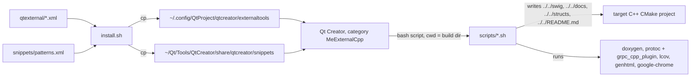

# qt-templates - documentation hub

qt-templates is a set of Qt Creator add-ons for C++ CMake projects on Linux:
four Bash scripts that Qt Creator runs as external tools (SWIG bindings for
Python, Doxygen documentation, protobuf with gRPC, lcov coverage), the four
external-tool definitions that put those scripts in a `MeExternalCpp`
category, and 23 C++ editor snippets. `install.sh` copies the tool definitions
and the snippets into the places Qt Creator is configured from
(`install.sh:2-20`). Who uses it besides the author is not stated in the
repository (see [Open questions in SPEC.md](../SPEC.md#9-open-questions)).

## Status

- Last commit: `4892b0c`, 2026-11-08, "Merge pull request 'chore(core): bring
  qt-templates to revision 4.0.0' (#18) from test into release"
  (`git log -1`). 16 commits in total; tag `v1.0.0`.
- The product files (`install.sh`, `scripts/`, `qtexternal/`, `snippets/`)
  have not changed since the first commit `0219ae5` of 2025-04-17
  (`git log -- scripts snippets qtexternal install.sh`). Every commit after it
  (2026-08 and 2026-11) adds the README, the licence, `recipe.ps1`, the
  Claude Code hooks and the CI workflows.
- Tests: none for the scripts, the XML files or the snippets.
  `recipe.ps1 test` runs pytest and ruff over `.claude/` (`recipe.ps1:41-55`),
  which holds no Python file, so pytest collects nothing and its exit code 5
  is accepted (`recipe.ps1:47-48`).
- CI: five Gitea Actions workflows in `.gitea/workflows/` (`propose`, `test`,
  `release-gate`, `release`, `sweep`), all on a `windows` runner. There is no
  `.github/workflows/` directory, so the GitHub copy of the repository runs no
  CI (inference: GitHub Actions reads only `.github/workflows/`).
- TODO/FIXME: none in the scripts. The single `@todo` in the repository
  (`snippets/patterns.xml:2544`) is part of the text the `docs` snippet
  inserts, not a note about this project.
- Evidently unfinished: `structs_server_example.cc` and
  `structs_client_example.cc` are written entirely inside `/* ... */`
  (`scripts/protobuf.sh:133-196`, `208-312`); the snippet set has 22 Gang of
  Four patterns and no Observer (`grep -i observer snippets/patterns.xml`
  finds nothing).

## Layout

| Path | What it is |
|---|---|
| `install.sh` | Rewrites the script paths in `qtexternal/*.xml` and copies tools and snippets into Qt Creator's folders |
| `scripts/swig.sh` | Creates `swig/python/interface.i` and two `CMakeLists.txt` files in the target project |
| `scripts/documentation.sh` | Writes or reuses a `Doxyfile`, runs `doxygen`, opens the HTML in Google Chrome |
| `scripts/protobuf.sh` | Creates `structs/structs.proto`, runs `protoc` with the gRPC C++ plugin, writes two commented-out examples |
| `scripts/coverage.sh` | Captures and filters an lcov report, renders it with `genhtml`, opens it in Google Chrome |
| `scripts/README.md` | The edits each script expects in the target project's CMake files |
| `qtexternal/*.xml` | Four Qt Creator external-tool definitions (`coverage`, `documentation`, `protobuf`, `swig`) |
| `snippets/patterns.xml` | 23 C++ snippets: 22 `gof_*` design patterns and one `docs` Doxygen example |
| `recipe.ps1` | The repository's PowerShell interface: `test`, `info`, `clean`, and five verbs that do nothing |
| `CLAUDE.md` | Rules for work in the repository (issues, branch and commit grammar, merges) |
| `.claude/` | Claude Code settings, hooks (`gate.ps1`, `log.ps1`, `session-start-stop.ps1`), git hooks, ruff/pytest config, the `lab-ai-env` skill |
| `.gitea/` | CI workflows and the issue and pull request templates |
| `LICENSE` | MIT |

## Architecture

The product is files, not a running program. `install.sh` is run once; after
that Qt Creator starts each script with `bash <script>` in the active build
directory (`qtexternal/*.xml:8-10`); `swig.sh`, `documentation.sh` and
`protobuf.sh` write into the project two folders up (`../../`), and all but
`swig.sh` call command-line tools.



What each script talks to:

| Script | External programs it calls | Files it writes |
|---|---|---|
| `swig.sh` | none (the generated CMake files need SWIG, Threads and Python at configure time, `scripts/swig.sh:36-37,50-51`) | `../../swig/CMakeLists.txt`, `../../swig/python/{interface.i,CMakeLists.txt}`, only if absent |
| `documentation.sh` | `doxygen`, `google-chrome` if on `PATH` (`:78-86`) | `./Doxyfile`, `./docs/html/`, `../../docs/Doxyfile` and `../../README.md` if absent |
| `protobuf.sh` | `protoc`, `grpc_cpp_plugin` (`:12-31,103-108`) | `../../structs/structs.proto` and two example `.cc` files if absent; generated `*.pb.*`, `*.grpc.pb.*` |
| `coverage.sh` | `lcov`, `genhtml`, `google-chrome` (`:2-6`) | `./coverage.info`, `./coverage_report/` |

The repository tooling (`recipe.ps1`, `.claude/hooks/`, `.gitea/workflows/`)
is separate from the product and runs on Windows PowerShell; it is described in
[SPEC.md](../SPEC.md#33-repository-tooling).

## Build and run

There is nothing to build: `.\recipe.ps1 build` prints `nothing to build`
(`recipe.ps1:69-72`, run while writing this document).

Prerequisites, as far as the files name them (no version is pinned for any of
them except ruff):

- Linux with Bash and `sed -i` (`README.md:30`, `install.sh:10`).
- Qt Creator; the XML files were written by Qt Creator 15.0.1
  (`qtexternal/*.xml:2`). The snippet target folder exists only for a Qt
  installed by the online installer (`README.md:39-40`).
- For the scripts: `doxygen` (and Graphviz `dot`, since the Doxyfile sets
  `HAVE_DOT = YES`, `scripts/documentation.sh:46`), `protoc` and
  `grpc_cpp_plugin`, `lcov` and `genhtml`, `google-chrome`; SWIG, Python 3
  development files and CMake for the generated SWIG build.
- For `recipe.ps1 test`: PowerShell, git, Python with pytest and ruff; ruff
  must be exactly 0.16.1 (`.claude/ruff.toml:2`). pytest's version is not
  pinned in any tracked file.

Install (source: `README.md:30-34`), from the repository folder:

```bash
./install.sh
```

Then restart Qt Creator (`install.sh:24`). The install edits the tracked
`qtexternal/*.xml` in place, so `git status` shows them as modified
afterwards (`README.md:36-38`, `install.sh:10`).

Run a script without Qt Creator, the way the tool definitions do
(derived from `qtexternal/coverage.xml:8-10`):

```bash
cd <project>/build/<kit>
bash <this repository>/scripts/coverage.sh
```

## Configuration

None of the scripts reads a command-line argument or a variable of its own;
everything is fixed in the files.

| Name | Where | Meaning | Default |
|---|---|---|---|
| `<arguments>` | `qtexternal/*.xml:9` | Script path that Qt Creator passes to `bash` | A path in the author's home directory; `install.sh:10` rewrites it to `$(pwd)/scripts/<name>.sh` |
| `<workingdirectory>` | `qtexternal/*.xml:10` | Directory the script runs in | `%{ActiveProject:BuildConfig:Path}` |
| `HOME` | `install.sh:2-20` | Base of both target folders | from the environment |
| `PROTO_DIR`, `PROTO_FILE` | `scripts/protobuf.sh:7-8` | Folder and name of the `.proto` file | `../../structs`, `structs.proto` |
| `LIBS_FOR_SWIG` | generated `swig/CMakeLists.txt` (`scripts/swig.sh:34`) | Libraries linked into `swig_python` | `set_it` (placeholder, to be edited, `scripts/README.md:18-21`) |
| `PROJECT_NAME`, `INPUT` | generated `Doxyfile` (`scripts/documentation.sh:27,29`) | Doxygen project name and input folder | `"MyProject"`, `../../` |
| `PYTHONLIBS_VERSION_STRING` | shell environment when `swig.sh` runs (`scripts/swig.sh:51`) | Expanded into the generated `find_package(PythonInterp ...)` line | unset, so the line gets an empty version |
| `.claude/.env` | `recipe.ps1:30-38` | `NAME=value` lines loaded into the environment unless the variable is already set | absent; gitignored (`.gitignore:24`) |
| `PYTHONIOENCODING`, `PYTHONUTF8`, `MSYS_NO_PATHCONV` | `.claude/settings.json:3-5` | Environment for Claude Code sessions | `utf-8`, `1`, `1` |
| `LAB_BOT_TOKEN` | secret in every `.gitea/workflows/*.yaml` | Gitea API token of the CI bot | none in the repository |
| `WAIT_MINUTES` | `.gitea/workflows/release-gate.yaml:101` | How long the manual gate waits for a verdict | `150` |

`recipe.ps1` takes one positional verb: `build`, `install`, `uninstall`,
`clean`, `run`, `publish`, `info` or `test` (`recipe.ps1:3`). The
`$RunArgs` parameter is declared (`recipe.ps1:6`) and used nowhere.

## Usage

1. Install into Qt Creator: `./install.sh` in the repository folder, then
   restart Qt Creator (`README.md:30-40`).
2. SWIG module: run `Swig`, add `add_subdirectory(swig)` to the project's
   main `CMakeLists.txt`, put your header into `swig/python/interface.i`,
   set `LIBS_FOR_SWIG` in `swig/CMakeLists.txt` (`scripts/README.md:3-21`).
   The generated `interface.i` names `my_class/my_class.hpp`
   (`scripts/swig.sh:17-19`); `scripts/README.md:13-15` shows `.h`.
3. Documentation: run `Documentation`. The first run writes
   `../../docs/Doxyfile`; later runs copy that file back into the build
   folder before running `doxygen` (`scripts/documentation.sh:16-62`).
4. Protobuf and gRPC: run `Structures`, edit `structs/structs.proto`, add the
   CMake lines from `scripts/README.md:33-39`. To try the examples, remove the
   `/* */` around them first (inference: as written they define no `main`) and
   compile with the `g++` commands in `scripts/README.md:40-63`, run in the
   `structs` folder (the README says `struct`).
5. Coverage: add `--coverage` to `CMAKE_CXX_FLAGS` and `CMAKE_C_FLAGS`
   (`scripts/README.md:23-28`), build, run the tests, then run
   `Test coverage`.
6. Snippets: in a C++ editor, type a trigger such as `gof_singleton`,
   `gof_visitor` or `docs` (`snippets/patterns.xml:3,2301,2448`).

## Testing

- `.\recipe.ps1 test` (`README.md:50-51`, `CLAUDE.md` rule 3) sets
  `core.hooksPath`, runs `python -m pytest .claude`, `python -m ruff check
  .claude` and `python -m ruff format .claude`, the last one in place
  (`recipe.ps1:42-53`). It covers no product file.
- CI runs the same verb and then `git diff --exit-code`
  (`.gitea/workflows/propose.yaml:144-152`, `test.yaml:54-58`,
  `release-gate.yaml:49-53`).
- The manual gate reads `tests/manual/tests.json`; the file does not exist, so
  the list is empty and the gate posts success
  (`.gitea/workflows/release-gate.yaml:107-150`).
- Nothing checks the shell scripts, the XML files or the snippets. While
  writing this document, `bash -n` passed for all five shell scripts and all
  five XML files parsed with Python's `xml.etree` (23 `<snippet>` elements).

## Known limitations and problems

- Linux only: Bash, `sed -i`, `$HOME/.config/...`, `google-chrome`. The
  repository tooling, in contrast, is PowerShell on a Windows runner.
- The scripts assume the build folder is two levels below the project root
  (`../../`), which holds only for a `build/<kit>` layout (`README.md:44-46`).
  `documentation.sh` writes there too (`../../docs`, `../../README.md`),
  which `README.md:44` does not list.
- `install.sh` has no `set -e` and prints `Installation completed
  successfully.` whatever happened before (`install.sh:23`). It creates the
  external-tools folder but not the snippets folder (`install.sh:3-5,20`). It
  works only from the repository folder: it uses `$(pwd)` and relative globs
  (`install.sh:9-20`).
- `swig.sh:51` writes `${PYTHONLIBS_VERSION_STRING}` without the `\` that
  the other lines use, so Bash expands it when the file is generated; the
  generated line normally reads `find_package(PythonInterp  REQUIRED)`.
- `documentation.sh` prints `Doxyfile already exists. Overwriting...`
  (`:17`) when it copies the project's `docs/Doxyfile` over the build-folder
  copy; the project's file is not overwritten. `INPUT = ../../` with
  `RECURSIVE = YES` and no `EXCLUDE` (`:29-30`) also scans the build folder
  inside the project (inference).
- `coverage.sh` has no shebang, no `set -e` and no check for `lcov`,
  `genhtml` or `google-chrome`. Its filter removes every path matching
  `*/src/*`, `*/include/*`, `*/lib/*`, `*/build/*`, `*/test/*`, `*/tests/*`,
  `*/third_party/*` and `/usr/*` (`scripts/coverage.sh:4`), so sources kept
  in `src/` or `include/` do not appear in the report. `sleep 2` (`:3`) has
  no stated reason.
- `protobuf.sh` prints `--lpthread` (`:117`) and
  `protobuf_generate_grpc_cpp` (`:124`) in its hints; neither is defined or
  checked in this repository. The commented-out example server listens on
  `0.0.0.0:50051` with `InsecureServerCredentials()` (`:174-179`).
- `README.md:42-43` says none of the tools is checked; `protobuf.sh` does
  check `protoc` and `grpc_cpp_plugin` (`:12-31`) and `documentation.sh`
  checks `google-chrome` (`:81`). `README.md:52` says the other verbs print
  `nothing to <verb>`; `clean` deletes cache folders instead
  (`recipe.ps1:63-68`).
- The lab-requirements link in `README.md:61` points to `127.0.0.1:3000`, a
  loopback address, so it opens only on the machine that serves it.
- `release.yaml` skips publishing when the tag `v$Version` exists
  (`.gitea/workflows/release.yaml:45-60`); `$Version` is `1.0.0`
  (`recipe.ps1:11`) and tag `v1.0.0` exists, so a push to `release` publishes
  nothing until the version changes.
- On the machine where this document was written, `python -m ruff` reported
  `No module named ruff`, so `recipe.ps1 test` would stop at its ruff step
  there (`recipe.ps1:49-50`).

## Related documents

- [README.md](../README.md) - project overview and install
- [SPEC.md](../SPEC.md) - requirements reverse-engineered from the code
- [scripts/README.md](../scripts/README.md) - CMake edits each script expects
- [CLAUDE.md](../CLAUDE.md) - rules for working in the repository
- [.claude/skills/lab-ai-env/SKILL.md](../.claude/skills/lab-ai-env/SKILL.md) - the AI-environment report skill
- [.gitea/issue_template.md](../.gitea/issue_template.md), [.gitea/pull_request_template.md](../.gitea/pull_request_template.md)
- [LICENSE](../LICENSE)

## About this document

Written on 2026-11-18 from commit `4892b0c` (branch `docs/spec-and-docs`,
from `origin/release`).

Commands run to check it (all read-only):

- `git status -sb`, `git log`, `git ls-files`, `git ls-files -s`,
  `git branch -a`, `git tag`, `git remote -v`
- `bash -n` on `install.sh` and `scripts/*.sh` - all passed
- `python -I -c` with `xml.etree.ElementTree` over `qtexternal/*.xml` and
  `snippets/patterns.xml` - all parsed, 23 snippets
- `grep` for `TODO`/`FIXME`, `observer`, script arguments
- `.\recipe.ps1 info` - printed name, code, version 1.0.0, summary; exit 0
- `.\recipe.ps1 build` - `nothing to build`; exit 0
- `python -m pytest --collect-only -q -p no:cacheprovider .claude` -
  `no tests collected`, exit 5 (pytest 9.1.1)
- `python -m ruff check --no-cache .claude` - `No module named ruff`

Not run: `./install.sh` (writes into `$HOME` and edits tracked files), any of
`scripts/*.sh` (they write into a target project and need the external
tools), `.\recipe.ps1 test` (sets `core.hooksPath` and formats files in
place), and the CI workflows (they need the Gitea server and its runner).
